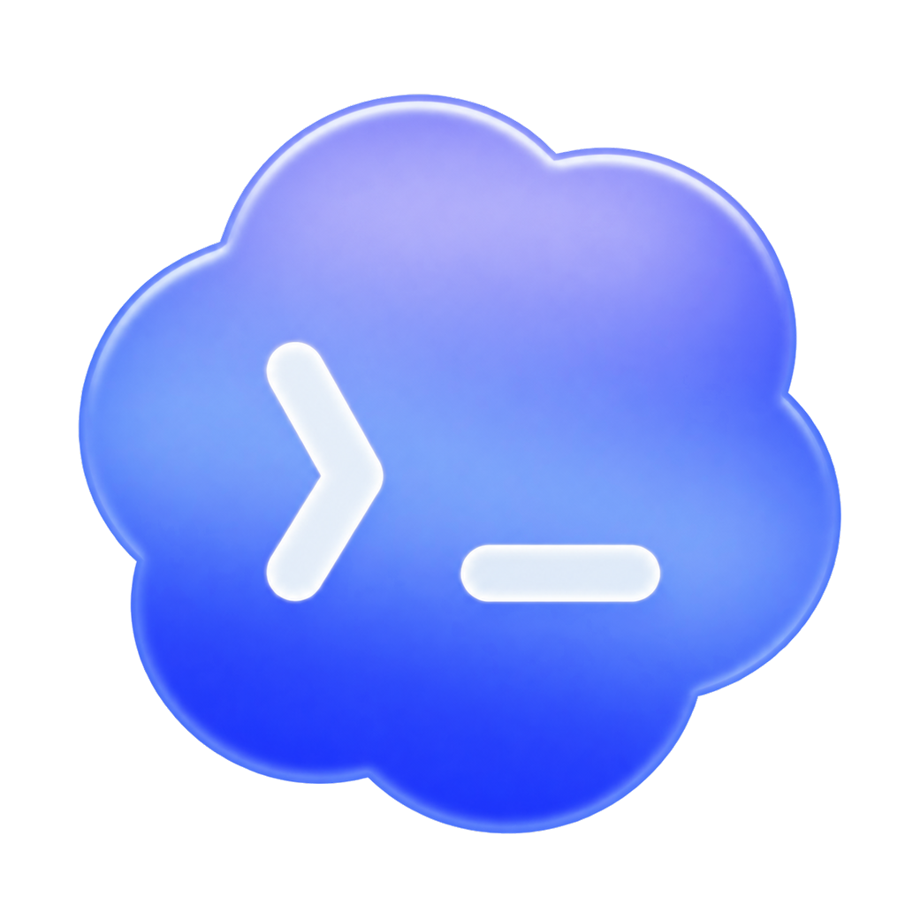
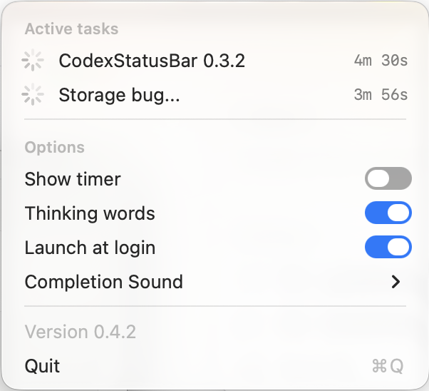

<p align="center">
  
</p>

# Codex Status Bar

A tiny native macOS menu-bar app that shows live Codex Desktop, Claude Desktop, and terminal task
state.

It reconciles Codex Desktop's own task catalog with live runtime status and lifecycle events and installs local Claude Code
hooks without clobbering unrelated hooks. SSH monitoring uses host aliases already configured in
Codex. Codex task names are copied from the same catalog Codex uses, so renaming a chat updates the
menu row.

<p align="center">
  
</p>

## Lineage and credit

This edition builds on [Lasse's Codex Status Bar](https://github.com/lassejlv/codex-status-bar), which adapted [Mick Cesanek's original Claude Status Bar](https://github.com/m1ckc3s/claude-status-bar) for Codex. Their architecture, interface ideas, and MIT-licensed work made this project possible.

- **Mick Cesanek** created the original Claude Status Bar and its native macOS menu-bar design.
- **Lasse** created the first Codex fork, including Codex lifecycle support and the pet-based interface.
- **This edition** is maintained by [Nick Mauro](https://github.com/nickxma) as a focused, zero-setup companion for Codex Desktop.

The original MIT copyright and license are preserved in [LICENSE](LICENSE), with additional detail in [ACKNOWLEDGEMENTS.md](ACKNOWLEDGEMENTS.md).

## How this edition differs

| Area | Earlier Codex fork | This edition |
| --- | --- | --- |
| Codex surfaces | CLI and Desktop integration | Codex Desktop across local, SSH, and Remote Control connections, plus Claude Desktop/CLI rows |
| Setup | Codex hooks and a bundled helper | Zero-setup Codex monitoring plus local, merge-safe Claude hooks |
| Activity detection | Hook-driven status plus Desktop compatibility | Desktop task registry plus event-driven lifecycle monitoring |
| Menu | Pet selection, animation, and mixed session rows | Clickable Active/Recently completed rows, origin pills, an animated status mark, thinking words, timer, and sound |
| Session list | Multiple Codex surfaces and workspace-oriented rows | Exact Codex user tasks plus Claude Desktop and terminal sessions |
| Completed tasks | General idle-session retention | Shown under Recently completed for 15 minutes by default |
| Background behavior | Tied to Codex/session lifecycle | Lightweight login utility that is ready whenever Codex opens |
| Distribution | Source-oriented fork | Tested universal DMG for Apple Silicon and Intel, built by GitHub Actions |

This is a substantial derivative, not an official successor. Upstream credit does not imply that Mick or Lasse endorses or maintains this edition.

## What it shows

- A monochrome Codex cloud-terminal logo that automatically matches the macOS menu bar in light and dark appearances.
- A subtle logo animation while any task is active; macOS Reduce Motion disables it automatically.
- A rotating Claude-style thinking word while Codex works (`Pondering…`, `Brewing…`, `Tinkering…`).
- The full elapsed time of the current turn, including thinking and tool use.
- A yellow indicator when Codex needs permission.
- Independent **Thinking words** and **Show timer** toggles. Turning thinking words off makes the
  menu bar icon-only; row and tooltip state text remains available.
- A completion sound after every turn by default, optionally limited to turns longer than 1, 5, or 15 minutes.
- Automatic launch at login, with an in-app toggle.
- Exact Codex task titles for active sessions on local, SSH, and Remote
  Control connections. SSH rows use the remote title index when available, otherwise a clear
  `host · workspace` label.
- Every row carries a **CODEX**, **CLAUDE**, or **CLI** origin pill. Clicking a Codex row opens that
  exact conversation; Claude Desktop and CLI rows focus their originating app.

The app collects no telemetry and uses no API key. It reads Codex Desktop's local task catalog,
lifecycle logs, and session metadata, and follows its local cross-window runtime-status stream.
Stream frames can include conversation content; the app discards it and retains only status and
revision metadata. Its optional Claude Code rows use
local Node-based hooks installed into the existing Claude settings without replacing unrelated hooks.
While Codex is connected to a configured SSH machine, the app uses that existing alias in
non-interactive mode to read lifecycle-only data from the remote `~/.codex` directory. Remote
Control task identity comes from Codex Desktop's local catalog and live status from its local stream; the
app does not connect directly to Remote Control hosts.

SSH remotes must already support key-based login through their Codex alias. An SSH agent such as
1Password may require a one-time approval for the status app's connection. Each attempt has a
10-second timeout; after an authentication failure the app leaves that host alone until its next
launch, so local monitoring continues without stuck workers or repeated approval prompts.

## Build and install

Requires macOS 13 or later.

### Install the app

1. Download the latest `CodexStatusBar.dmg` from [Releases](https://github.com/nickxma/codex-status-bar/releases/latest).
2. Drag **CodexStatusBar** into Applications.
3. Open the app. Official GitHub releases are signed with a Developer ID certificate and notarized
   by Apple, so they pass Gatekeeper without a right-click workaround.

Each release also includes `CodexStatusBar.dmg.sha256` for download verification.

The app launches at login by default. Disable **Launch at login** from its menu at any time.

### Build from source

Building requires Xcode Command Line Tools.

```bash
./build.sh
open build/CodexStatusBar.app
```

For a DMG:

```bash
./build.sh --dmg
```

Builds are native to the current Mac by default. A release runner with full Xcode can produce a universal binary with `BUILD_ARCH=universal ./build.sh --dmg`. Local builds without a Developer ID certificate remain ad-hoc signed and are intended for development only.

Move the app to `/Applications` or `~/Applications`, then open it once. It enables **Launch at login** by default and remains as a lightweight menu-bar utility so it can notice Codex opening later.

## Session behavior

- A session appears when Codex records its first real `task_started` lifecycle event. Merely opening a conversation does not add a row.
- Every active task is shown under **Active**, ordered by recent activity.
- Resting tasks remain under **Recently completed** for the configured hide-idle window (15 minutes
  by default). When both sections are empty, the session area is blank.
- Clicking a Codex task follows `codex://threads/<thread-id>`, including Remote Control tasks whose
  host is resolved by Codex Desktop. Claude Desktop rows focus Claude; CLI rows raise the terminal
  or editor recorded in `TERM_PROGRAM`.
- Live runtime status takes precedence over cached lifecycle state. Lost owners, missed stream
  revisions, and unconfirmed registry-only activity appear under **Status unavailable**.
- Lifecycle-only fallback states expire after 30 minutes without an update. File watchers are
  reconciled periodically, and partial JSON lines remain buffered until complete.
- Row names come from Codex Desktop's cross-host task catalog or task-title index. Recent catalog
  changes are reconciled even when a Codex update changes its diagnostic log format.
- SSH remote sessions follow the same appearance, ordering, and expiry rules as local
  sessions. The desktop's remote-project assignment map distinguishes visible tasks from internal
  helpers, including top-level tasks whose remote transcript source is labeled `subagent`. SSH
  connections are multiplexed and attempted only while Codex Desktop is running.
- Remote Control sessions follow the same desktop runtime stream, so they need no SSH alias.
  This local IPC protocol is versioned but internal to Codex. If a desktop update changes it,
  unsupported live states are unavailable rather than guessed.

## Contributing

PRs are welcome. [Fork this repo](https://github.com/nickxma/codex-status-bar/fork), push your branch to your fork, and open a pull request against `nickxma/codex-status-bar:main`. You don't need collaborator access.

See [CONTRIBUTING.md](CONTRIBUTING.md) for setup, checks, and instructions if you already have changes ready but can't push a branch.

## Testing

```bash
scripts/test.sh
swiftc -typecheck Sources/*.swift -framework Cocoa -framework ServiceManagement
./build.sh
```

See [PRIVACY.md](PRIVACY.md), [TROUBLESHOOTING.md](TROUBLESHOOTING.md), and [CONTRIBUTING.md](CONTRIBUTING.md).

## License

MIT

## Trademark / not affiliated

This is an unofficial open-source project. It is not affiliated with, endorsed by, or sponsored by OpenAI or Anthropic. Codex and OpenAI are trademarks of OpenAI. Claude is a trademark of Anthropic. The MIT license does not grant trademark rights.
